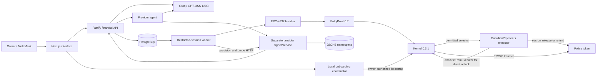

# Technical Documentation — Guardian Wallet: Astra

- **Track:** International Track, Topic F — Agent Wallet.
- **Last aligned:** October 20, 2026, against `feat/batching-evaluation` and the current team-supplied materials.
- **Verified runtime baseline:** `d5517adc9d551ba6df36b53a357001bb35edd981`. The [submission index](README.md) identifies the deployed build, selected UI, materials and exact-revision procedure.
- **Related documents:** [source, deployment and tests](02-source-code-deployment-and-tests.md), [security self-assessment](03-security-self-assessment.md), [presentation material](PRESENTATION_MATERIAL.md).

## 1. Purpose and implemented scope

Guardian Wallet lets an owner delegate a bounded procurement task to Astra. Models interpret
natural-language instructions and return structured decisions. Deterministic code verifies
authenticated invoices, a restricted worker prepares and submits operations, and on-chain
policy determines whether the requested payment can execute.

`GuardianPayments` is a separate **ERC-7579 executor contract installed on Kernel**. It stores
policy and accounting per smart account and calls Kernel's `executeFromExecutor` to transfer
tokens. It does not assume delegatecall execution inside Kernel storage. Direct payments
use account-held tokens; escrow temporarily holds the quoted amount in Guardian.

The evaluated service is an expiring PostgreSQL JSONB key/value namespace operated by the
team. Public receipts use Base Sepolia, chain ID **84532**, and six-decimal **MockUSD**.
MockUSD is a test token, not USDC, redeemable USD, or evidence of a commercial dollar price.

### Features and parameters

| Area | Current implementation |
| --- | --- |
| Selected AI | Groq `openai/gpt-oss-120b`; 20B is an explicit comparator. Reviewed alternatives, legacy Ollama and the deterministic baseline are selected explicitly, with no automatic model fallback. |
| User interface | `/setup`, `/dashboard`, `/review`, `/evidence`; wallet instructions support English and Indonesian. |
| Demo bootstrap | 10 MockUSD allocation; protected reserve 6, per-payment limit 1, fixed UTC-day cap 2. |
| Small catalog offer | 1 MiB, 1 hour, 260000 base units = 0.26 MockUSD. |
| Standard catalog offer | 4 MiB, 4 hours, 520000 base units = 0.52 MockUSD. |
| Settlement | Owner runtime defaults to direct; opt-in escrow supports one invoice. The current reviewer factory exercises escrow on an isolated fork. |
| Direct batching | 1–10 compatible invoices; default size 1, default window 0, maximum window 30000 ms. |

The UI uses MB labels; the service implementation multiplies capacity by `1024 × 1024` bytes.
The prototype supports one configured owner/account per financial API instance. Trading,
swaps, staking, arbitrary-recipient transfers and model-controlled policy changes are outside scope.

## 2. Architecture and authority boundaries



| Component | Responsibility | Authority boundary |
| --- | --- | --- |
| Web | Owner setup, wallet activity, assistant, evidence and reviewer entry | Receives public configuration and short-lived access tokens, not server signing secrets. |
| Financial API | Owner authentication, policy/assets, quote validation, planning and task management | Holds no owner or worker session signing key. |
| Model/planner | Bounded intent, offer or pay/wait/needs-owner decision and summary | Cannot supply new signing authority, raw transaction calldata or invoice financial fields. |
| Database | Tasks, attempts, batch membership, leases, provider invoices and namespaces | Accessed through privileged server processes; public-role access is restricted by RLS. |
| Worker | Fresh validation, restricted signing, persist-before-send, reconciliation and fulfillment | Holds only the delegated session; does not run model inference alongside that credential. |
| Provider agent | Model-backed fixed-catalog offer assessment | Has no provider signing key. |
| Provider signer/service | Catalog quote signatures, payment-proof checks, delivery attestations and namespace management | Separate process; has no owner/session key. Provider readiness remains a trust assumption. |
| Kernel / EntryPoint / Guardian | Smart-account authorization and policy enforcement | Kernel retains owner/root control; Guardian guards the enabled payment route. |
| Reviewer host | Capability-scoped disposable workspace | Generates fork-only owner/session/provider credentials, independent of the public owner's credentials. |

The implementation uses TypeScript, Next.js/React, Fastify, Zod, viem, PostgreSQL/Drizzle,
PGlite, Solidity **0.8.28**, OpenZeppelin cryptography/reentrancy primitives, Kernel **0.3.1**,
EntryPoint **0.7**, Hardhat, Vitest and Playwright.

## 3. User workflows and API

### Owner setup and authentication

The owner separately signs API login, bootstrap deployment and Kernel session authorization.
The owner key remains in MetaMask. The loopback onboarding coordinator checks the fixed
bootstrap intent, signatures, nonce/factory state and gas/paymaster bounds, journals submission,
then synchronizes deployment/session configuration for the financial runtime.

Financial API login uses a custom EIP-191 domain/chain/address-bound challenge, not a claim
of complete SIWE or contract-owner enrollment support. Nonces are consumed once and expire
after **5 minutes**; bearer sessions expire after **15 minutes** and remain server-instance local.
Setup and financial API sessions are separate. The frontend restores tab-local `sessionStorage`
only after checking wallet account, network, expiry and `/auth/session`; restoration does not
renew on-chain authority. Account/network changes, expiry or a relevant 401 invalidate login.

### Two procurement entry paths

1. **Wallet assistant:** obtain a catalog invoice, store an eligible result as a non-executable
   `draft`, show budget/risk/payment review, then explicitly release selected tasks to the queue.
2. **Direct service request:** `/v1/procure` can store an eligible result directly as `planned`.
   It may execute promptly when the scheduler is already running.

Queue release rechecks account ownership, existing attempts, quote/policy validity and capacity
under an account lock. It does not start a worker, clear a pause or grant additional permission.
The owner uses **Start agent** to enable scheduling; the worker process must also be running.

### Payment and service lifecycle

```text
Assistant draft -> reviewed planned task -> claim -> fresh validation/simulation
  -> restricted signing -> persist exact payload/hash/membership -> submit
  -> reconcile canonical operation and Guardian evidence
     Direct: paid -> signed delivery + fresh probe -> completed
     Escrow: escrowed -> staged delivery/probe -> release -> activation -> completed
                         or deadline passed -> refund transaction -> refunded
```

The UI polls persisted state. It does not infer success from a model response or a submission hash.

| State layer | Values / interpretation |
| --- | --- |
| Payment task | `draft`, `queued`, `planned`, `waiting`, `needs_owner`, `rejected`, `executing`, `escrowed`, `paid`, `service_pending`, `completed`, `refunded`, `cancelled`. |
| Payment/escrow-action attempt | `prepared`, `submitting`, `submitted`, `unknown`, `confirmed`, `failed`, `needs_review`. |
| Reconciliation result | `pending` means insufficient evidence; it is not a terminal task state or proof an operation was dropped. |
| Escrow substate | Tracks lock/release/refund status and their separate transaction hashes. |

Assistant queue release responds with `status: queued`, while ready tasks are stored as `planned`.
`needs_review` is an operation status, not a payment-task enum value: a task can remain
`executing`/`escrowed` while its operation requires review. UserOperation and transaction hashes
are distinct. Expired unsubmitted invoices can be cancelled; existing operations are preserved.

### Principal endpoints

| Endpoint | Purpose |
| --- | --- |
| `/health`, `/v1/status` | Process health and configuration status, not full financial readiness. |
| `/auth/nonce`, `/auth/verify`, `/auth/session` | Owner authentication and session validation. |
| `/v1/assets`, `/v1/risk`, `/v1/policy` | Deterministic wallet/policy reads without inference. |
| `/v1/assistant`, `/v1/assistant/execute` | Interpretation, draft/review and explicit queue release. |
| `/v1/procure`, `/v1/tasks`, `/v1/tasks/:id` | Direct procurement and active-account task views. |
| `/v1/tasks/:id/cancel`, `/v1/tasks/:id/retry-delivery` | Manage eligible tasks without discarding or repaying a submitted operation. |
| `/agent/start`, `/agent/pause` | Local scheduling controls, separate from on-chain pause/revocation. |
| `/v1/tasks/:id/probe`, `/v1/tasks/:id/database` | Verified namespace probe and KV access for completed services. |

Financial routes require configuration and owner authentication. `/api/review/` instead proxies
the allowed routes of one disposable workspace through its short-lived capability.

## 4. Core algorithms

### Budget calculation and plan construction

Token amounts use integer base-unit strings/`bigint`, not floating-point payment arithmetic.

```text
available = max(0,
  min(balance - protected_reserve, daily_cap - spent) - queued_commitments)
```

Native gas and token reserve are separate. The spending day is `floor(timestamp / 86400)`,
a fixed UTC window rather than rolling 24 hours.

- The API verifies the registered quote signature/account/chain; procurement binds offer,
  invoice, service hash and price to the fixed catalog.
- `BoundedPaymentPlanner` checks account/token/chain, policy activity, time, per-invoice cap,
  daily capacity and reserve. The model supplies only a decision/summary; code constructs `PaymentPlan`.
- Assistant review/queue additionally checks active-account task ownership, existing attempts,
  commitments and fresh state. The store recalculates capacity under the account lock.
- The driver revalidates signatures, recipient allowlist, policy version, consumed IDs and
  budget before preparing an operation; the contract validates again during execution.
- A plan records observed block/hash/time, policy version and original quotes. Its deadline
  is at most `min(quote expiry, policy expiry, observedAt + 120 seconds)`. Worker wall-clock
  checks prevent a stalled RPC clock from keeping an expired plan executable off-chain.

Wallet intent `unsupported` is distinct from planner outcomes `planned`, `waiting`,
`needs_owner` and `rejected`; none changes the owner's permission.

### Bounded direct-payment batching

Batch selection combines already-approved compatible plans: owner/account, chain, module,
policy version, token, original quote and model provenance must match. Selection is
deterministic and respects each invoice cap, aggregate capacity and earliest original deadline.
Maximum size is **10**, maximum waiting window **30 seconds**; defaults are size **1**/window **0**.
All members share one durable signed operation and atomically reconciled settlement result.
Fulfillment remains separate per service. Escrow mode does not batch invoices.

### Atomic Guardian settlement

Guardian checks installation/pause, policy version/time, signed quote binding, allowed recipient,
positive amount, per-payment limit, batch size and permanently consumed payment IDs. It sums
the batch and enforces:

```text
spent_utc_day + batch_total <= daily_limit
balance_before >= protected_balance + batch_total
balance_after >= protected_balance
balance_before - balance_after == batch_total
```

Spending/IDs are reserved before external interaction. A module-wide `ReentrancyGuard`,
account-call transfer return checks and post-transfer invariants protect the tested route.
Kernel performs direct/lock token transfers through `executeFromExecutor`. A failing item
reverts the entire batch and its counters/IDs; consumed gas is not refunded. Unsupported
fee/rebase/non-standard token behavior is outside the asset guarantee.

### Persist-before-send and reconciliation

1. Acquire an account lease/fencing token and read current state.
2. Prepare/sign the exact restricted UserOperation, computing its expected hash and keyed nonce.
3. Commit payload, hash, nonce, expiry and task/batch membership **before** network send.
4. On a lost response, retain `unknown`; do not create a fresh-nonce payment automatically.
5. Match canonical receipt/block/confirmations, EntryPoint hash/sender/nonce/success, Guardian
   settlement events and consumed IDs. Outer transaction success alone is insufficient.
6. Insufficient evidence remains `pending`; conflicts or unresolved attempts beyond the active
   five-minute window enter `needs_review` and pause scheduling. Existing payment reconciliation
   takes precedence even while paused. Fulfillment and escrow-action submission are separate phases.

Direct confirmed settlement becomes `paid`; lock confirmation becomes `escrowed`. Delivery
retries do not repay invoices. Automatic fee replacement and complete operator resolution for
terminal/ambiguous attempts remain outside the implemented workflow.

### Escrow, fulfillment and rental lifetime

`lockPayment` checks quote/policy/cap/reserve, consumes the invoice and moves one amount into
Guardian custody. The provider creates a `ready=false` namespace, signed delivery and EIP-712
`EscrowDelivery`. The worker verifies binding/signatures and a staged probe before preparing release.
Release/refund operations have their own durable `escrow_operations` journal and reconciliation.
Normal namespace access activates only after a confirmed matching release.

If a lock remains unreleased and `block.timestamp > refundAfter`, anyone may **submit**
`refundEscrow`; contracts do not run an automatic timer. Worker recovery still depends on
runtime/gas/authorization. Worker window defaults to **600 seconds**, bounded to **30–86400**;
the contract maximum is **24 hours**. The driver checks recovery-window authority. Pending
escrows prevent module uninstall. Same-day refunds restore that day's spent capacity while
the invoice ID remains consumed; a new purchase requires a new invoice/request.

Direct fulfillment verifies a signed receipt and fresh probe after settlement. Escrow probes
the staged service before release, then verifies activation. Direct rental expiry is based on
settlement time; escrow uses provider receipt `readyAt`. `expiresAt` bounds access. Completion
records verification at that stage, not guaranteed full-period uptime or service quality.

## 5. Persistence and permission design

Migrations **0000–0007** define **11 RLS-enabled tables**. Active stores use `payment_tasks`,
`payment_attempts`, `payment_attempt_members`, `execution_locks`, `worker_controls`,
`escrow_operations`, `provider_invoices` and `provider_databases`. Legacy `goals/tasks/operations`
remain for compatibility. Partial unique indexes, membership constraints and fenced DB
transactions preserve the operation journal. Encoded JSON parameters bind through
`::text::jsonb`; object-only constraints reject invalid payload shapes.

RLS has no public-role policies; server connections remain privileged. Source migration
presence does not establish the migration level of a particular hosted database.

| Authority tier | Permitted role |
| --- | --- |
| Owner/root | Authorize deployment/session, configure policy/recipients, pause/unpause and revoke non-root sessions through owner authority. |
| Model | Bounded JSON interpretation/decision; no signing key or authority to change invoice fields. |
| Authenticated API | Read state, validate quotes, plan/manage tasks and release reviewed selections. |
| Worker/session | Guardian target/selector allowlist, CALL type, zero native call value and expiry; no arbitrary transfer/approval/admin or Kernel ERC-1271 authority. |
| Guardian | Separate per-account policy/accounting and direct/escrow enforcement. |
| Provider signer | Fixed-catalog quote/delivery signatures and namespace management, not owner authority. |
| Reviewer capability | Allowed routes for one disposable wallet/database/fork for a bounded lifetime. |

Default permission allows `executePayments`. Escrow authorization explicitly adds `lockPayment`,
`releaseEscrow` and `refundEscrow` while retaining `executePayments`; the escrow worker selects
the single-invoice lock path. Zero call value does not mean zero gas cost. Owner actions,
other modules and existing allowances remain separate trust boundaries.

## 6. Verification and evidence

| Recorded result | Scope and source |
| --- | --- |
| AI-01: 0.26 MockUSD direct settlement, signed delivery, probe and KV write/read | Public Base Sepolia, October 17; historical local Qwen run. [AI-01](../docs/evidence/AI-01-public-procurement.md). |
| Escrow lock/release and staged namespace activation | Public Base Sepolia, verified October 19; GPT-OSS 120B/Groq, separate Kernel index 1. [Receipt](../docs/evidence/public-escrow-procurement.json). |
| Model comparison | Eight selected cases/model: 120B 8/8, P50/P95 675/1008 ms; 20B 8/8, 580/621 ms. [Cloud validation](../docs/evidence/CLOUD-VALIDATION.md). |
| Cloud security regression | 60/60 observations on 30 cases repeated twice; baseline 54 passes and six inconclusive API/schema errors out of 60. In-sample regression. [Raw results](../docs/evidence/security-cloud-model-evaluation.json). |
| Bypass/revoke/recovery | Actual Kernel/EntryPoint fork plus explicit chain-driver fixtures, not public transactions. [Kernel evidence](../docs/evidence/security-kernel-fork.json). |
| COST-01, four invoices | Median enclosing EVM gas 1,086,084 single vs 449,692 batch: **58.59%** lower. |
| COST-01, seven invoices | 1,870,809 vs 600,987: **67.87%** lower. Three repetitions/mode on identical warmed fork snapshots; excludes production pricing/L1-data/model/hosting costs. [Raw cost data](../docs/evidence/cost-fork.json). |
| Local checkpoint, October 20 | **156 passed:** 105 integration, 8 web, 25 browser, 17 contract/fork and 1 Docker-context tooling. Lint/typecheck/build and source-only packaging passed. [Progress](../docs/PROGRESS.md). |
| Dependency scans | Latest recorded full and production scans: **0 known advisories** after the scoped esbuild override and clean `npm ci`; not an application audit. |

Recorded evidence retains its capture date and source provenance. Public namespace liveness
is historical after expiry; a selected model corpus is not universal injection resistance.
The full reproduction commands, environment setup and Docker verification boundary are in
the [deployment/test guide](02-source-code-deployment-and-tests.md).

## 7. Project references

- [Current README](../README.md), [technical design](../docs/technical-documentation.md), [wallet assistant](../docs/WALLET_ASSISTANT.md).
- [Security tracker](../docs/security-assessment.md), [escrow design](../docs/ESCROW_PROTOTYPE.md), [batching methodology](../docs/BATCHING_AND_COST.md).
- Implementation: [Guardian](../contracts/contracts/GuardianPayments.sol), [worker](../apps/worker/src/worker.ts), [payment schemas](../packages/shared/src/payments.ts), [payment store](../packages/database/src/payment-store.ts).
- [Historical archive](../docs/archive/README.md); the [submission index](README.md) links the active documents, decks and videos.

The current [technical deck](01-Technical-Documentation.pptx) has 10 slides. Four PPTX files
passed archive/XML integrity checks, and both videos passed sampled playback with decoded
audio and video. The submission index records the scope of those checks and actual durations.
